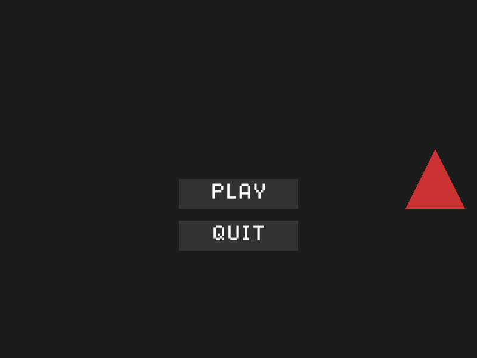
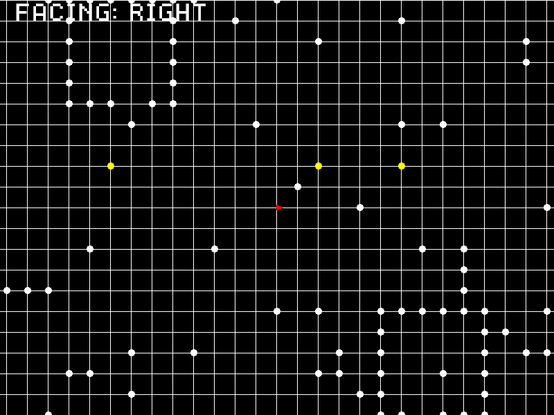
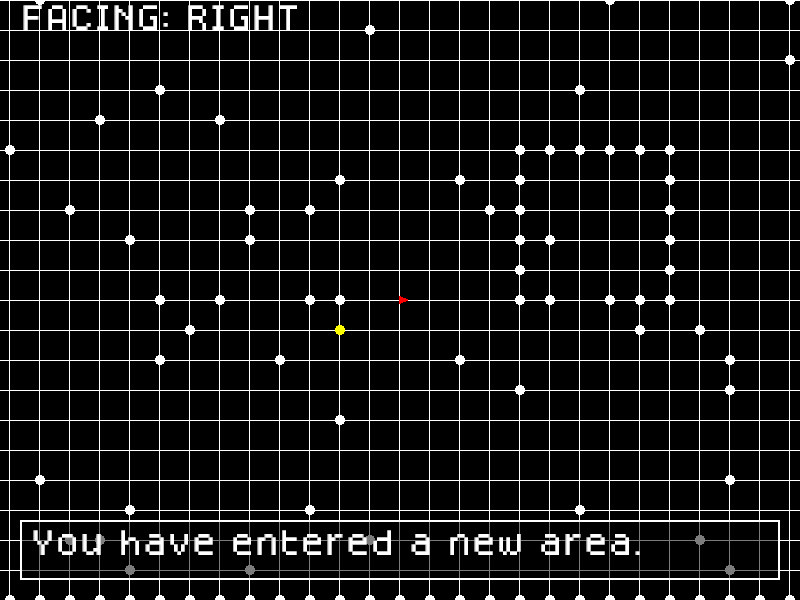
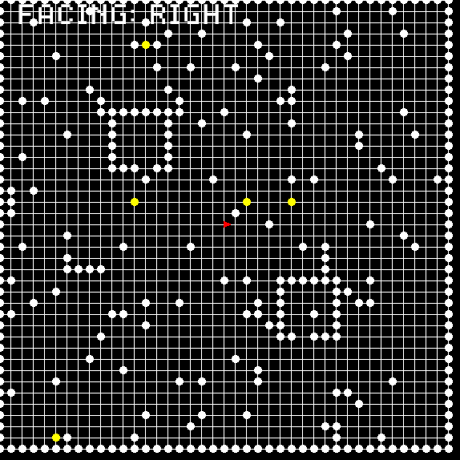

# INTERIM (Rust)

- **Genre:** Turn-based RPG (this Rust version is a grid-exploration demo; combat was never ported to Rust)
- **Language(s):** Rust (2021 edition)
- **Libraries/engine:** Piston (`piston`, `piston2d-graphics`, `pistoncore-glutin_window`, `piston2d-opengl_graphics`), `find_folder`, `rand`
- **Coding concepts demonstrated:**
  - Trait-based screen manager: a `Screen` trait with `draw` / `handle_input` / `update`, a `ScreenState` enum and a `ScreenManager` holding `Box<dyn Screen>` (`src/screens/mod.rs`)
  - Camera that follows the player and is clamped to the world bounds (`update_camera_position`, `src/screens/game.rs`)
  - Procedural maps: a tile matrix (`Vec<Vec<u8>>`) with a border, rectangular houses with doorways and random obstacles (`generate_map`, `add_house`, `src/screens/game.rs`)
  - Interactables placed on random free tiles and triggered with E, plus grid collision (`src/screens/game.rs`)
  - Timed text popups using `Instant` / `Duration` (`src/screens/popup.rs`)
  - Menu buttons with hover and click handling (`src/screens/main_menu.rs`)
  - Piston event loop and asset path resolved relative to the executable (`src/main.rs`)
- **Dates:** 15 November 2024 to 23 November 2024
- **Status:** Prototype. You can walk around a generated 41x41 grid and interact with markers. There is no combat, stats or story in the Rust code.

| Main menu | Generated map |
|---|---|
|  |  |

| Popup | Whole map |
|---|---|
|  |  |

## What this is

INTERIM is a turn-based RPG project I first wrote in Python and then restarted in Rust to learn the language. The Rust version only got as far as the engine side: screens, a map, a camera and a few interactions. The first commits in this repo are the earlier `RPG_3` state (crate name `RPG_3`, an 11x11 room). The latest version (`INTERIM_11`) is at the repo root and replaces it with a 41x41 generated map, houses, a camera and interactables.

Known loose ends: interactable destinations are not used (`destination_map` is always `None`), and Pause and Settings screens are declared but not implemented.

## Build and run

Needs a Rust toolchain and OpenGL 3.2.

```
cargo run
```

Controls: WASD to move one tile, E to interact, Esc to close the window. Run from the repo root so `assets/dogicapixel.ttf` is found (the game looks next to the executable first, then in `./assets`).

## Credits

- Font: Dogica Pixel by Roberto Mocci, SIL Open Font License 1.1 (`assets/OFL.txt`).
- Piston and the other crates are used under their own licences via Cargo.
